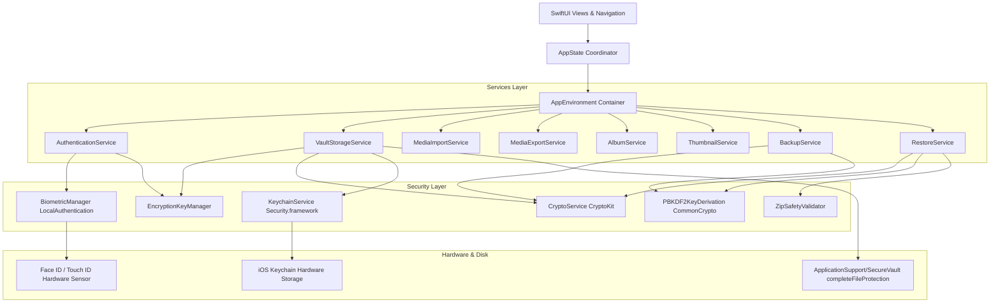
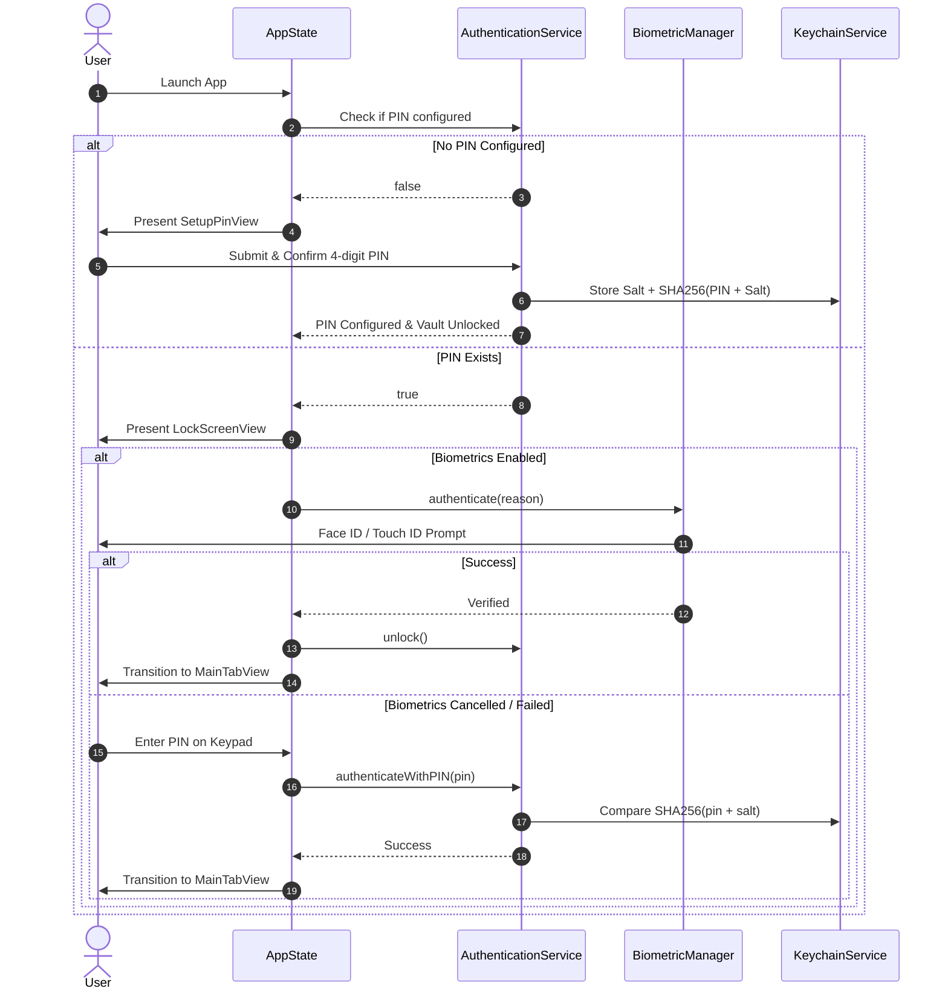
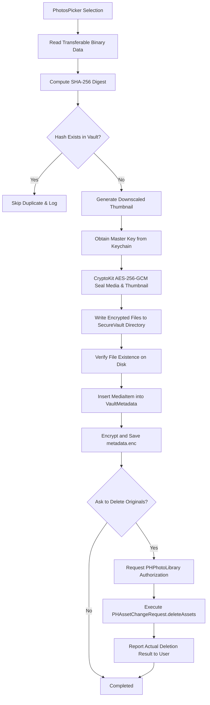
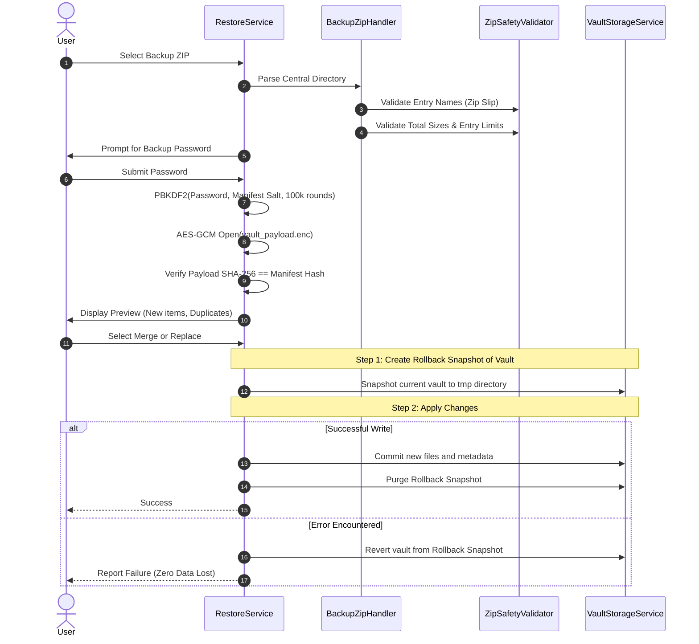

# PrivateVault Pro — Architectural Specification

This document details the software architecture, design patterns, data flows, and state management implemented in **PrivateVault Pro**.

---

## 1. High-Level System Architecture

The application is architected around the **Dependency Injection** pattern, decoupling the presentation layer from the persistence, cryptographic, and media services.



---

## 2. Authentication & Session Flow

The app enforces a fail-safe security boundary across all scene transitions:



---

## 3. Media Import Pipeline

When the user selects photos or videos via `PhotosPicker`, the import pipeline executes sequentially with atomic disk commits:



---

## 4. Encrypted Backup & Transactional Restore

### Backup Structure
A portable backup is formatted as an uncompressed, standard PKZip archive containing exactly two files:

```
PrivateVault_Backup_2026-10-29.zip
├── manifest.json       (Unencrypted plaintext manifest with KDF params, salt, SHA-256 hash)
└── vault_payload.enc   (AES-256-GCM encrypted payload containing metadata, media, thumbnails)
```

### Transactional Restore Sequence



---

## 5. Memory Management & Performance

- **Lazy UI Rendering:** SwiftUI `LazyVGrid` and `LazyVStack` guarantee that thumbnails are only inflated when visible within the viewport.
- **Two-Tier Thumbnail Cache:**
  - `NSCache` with a 100MB cost limit and 500-item eviction policy keeps active viewport thumbnails in memory without causing memory pressure or termination.
  - On-disk thumbnails (`.thumb.enc`) are downscaled to 320px maximum dimension, consuming ~30KB per photo rather than multi-megabyte raw files.
- **Video Decryption Streaming:** Videos are never buffered entirely in RAM. They are streamed via temporary file handles created with `NSFileProtectionComplete` inside `NSTemporaryDirectory()` and immediately purged upon playback view dismissal.
